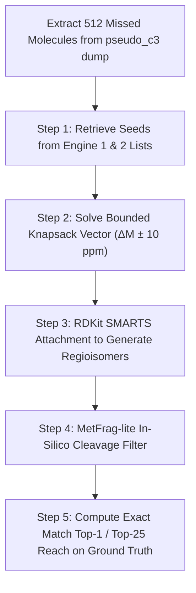

# Session Handoff Dossier
**Generated:** 2026-10-16 15:05:00
**Source Conversation ID:** 17ef0cee-efa0-480c-aff0-dbb5bf4f83f1
**Context Size:** ~146,000 tokens (Smart Zone Ceiling Reached)

## 1. High-Level Mission & Active Objective
- **Mission:** Expand the novel molecule generation pipeline beyond Engine 1's primitive 1-step chops by combining:
  1. **Biogenetic Knapsack Vector Mutator:** Solves multi-step precursor mass deficits ($\Delta M \pm 10\text{ ppm}$) using both additions ($+\text{O}, +\text{CH}_2, +\text{Hexose}$) and reductions ($-\text{H}_2\text{O}, -\text{H}_2, -\text{CH}_2$).
  2. **MetFrag-lite Rapid In-Silico Bond Cleavage:** Disconnects non-ring and ring bonds to prune impossible regioisomers (reducing 50–100 candidate isomers to the top ~5 that explain observed daughter peaks).
  3. **Leak-Free Forward Physics / Decoder Scoring:** Reranks survivors using spectral similarity rather than database popularity or leaky LightGBM.
- **Active Objective:** Benchmark this pipeline specifically on the **512 molecules missed by Engine 1** out of the 600 `pseudo_c3` validation set, without colliding with Claude's ongoing Colab A100 execution.

---

## 2. Settled Decisions (Do NOT Re-Litigate)
- **Decision 1: Zero Collision with Claude's Colab Job:**
  - *Rationale:* Claude (Terminal PID 2260) is running a detached A100 job for Gate K1 on Colab, interacting with Google Drive and `research/exploit/20261015-c3-gen-union`.
  - *Constraint:* All our new prototyping and benchmarking must run **locally on CPU**, using isolated scratch directories (`.scratch/knapsack_mutator/` or `scratch_pkg/`), never touching Colab CLI or Claude's lockfiles.
- **Decision 2: Abandon LightGBM & Database Priors for Novel Candidate Scoring:**
  - *Rationale:* LightGBM penalizes novel molecules because database popularity features (`#substances`, `#patents`, `#papers`) are all 0. Additionally, FPNet is leaky on `pseudo_c3` (trained on training spectra).
  - *Impact:* Novel mutants must be filtered using physics: MetFrag-lite explained intensity on CPU, followed by forward physics / decoder log $p$.
- **Decision 3: Constrain Knapsack Solver to Bounded Biological Edits:**
  - *Rationale:* Unconstrained integer combinations create chemically absurd structures and combinatorial explosion.
  - *Constraint:* Edit distance is bounded to depth $\le 3$ ($\sum |c_i| \le 3$), and tolerance is strictly bounded to $\pm 10\text{ ppm}$.
- **Decision 4: Metric Invariance (Tautomer-Canonical InChIKey14):**
  - *Rationale:* Stereocenters (R/S, E/Z) and tautomers are ignored by the CASMI metric. Candidate lists must deduplicate on InChIKey14 so slots are not wasted.

---

## 3. Ground Truth Data Locations & Existing Code
- **Validation Dataset:**
  - 600 `pseudo_c3` ground truths: [`E:/casmi/c3cal_check/pseudo_c3.parquet`](file:///E:/casmi/c3cal_check/pseudo_c3.parquet)
  - Pre-generated inputs & analog seeds: [`E:/casmi/c3_gen/p4_inputs.pkl`](file:///E:/casmi/c3_gen/p4_inputs.pkl)
  - Engine 1 results dump (identifying the 88 hits vs 512 misses): [`research/harness/dumps/pseudo_c3/post_dump/state.pkl`](file:///e:/ENVEDA_casmi/research/harness/dumps/pseudo_c3/post_dump/state.pkl)
- **Existing Physics / In Silico Fragmentation Code:**
  - MetFrag-lite implementation: [`scratch_pkg/casmi_scratch/metfrag.py`](file:///e:/ENVEDA_casmi/scratch_pkg/casmi_scratch/metfrag.py)
  - Mass & chemistry utilities: [`scratch_pkg/casmi_scratch/chem.py`](file:///e:/ENVEDA_casmi/scratch_pkg/casmi_scratch/chem.py)

---

## 4. Implementation Plan for the 512 Missed Molecules

### Detailed Steps:
1. **Script 1: Extraction & Baseline Alignment (`.scratch/extract_512_misses.py`):**
   - Read `state.pkl` from `research/harness/dumps/pseudo_c3/post_dump/`.
   - Separate the 88 molecules where Engine 1 placed the truth in the candidate list from the 512 misses.
   - Save the 512 query spectra, precursor masses, and ground-truth InChIKey14s to `.scratch/missed_512.pkl`.
2. **Script 2: Standalone Knapsack Mutator (`.scratch/knapsack_mutator.py`):**
   - Implement the bounded knapsack solver over biological basis vectors:
     - Additions: `+O` (15.9949), `+CH2` (14.0157), `+Hexose` (162.0528), `+O-CH2` (1.9793)
     - Chops: `-H2` (-2.0157), `-CH2` (-14.0157), `-H2O` (-18.0106), `-CO` (-27.9949)
   - Take seed scaffolds from top retrieved analogs and generate regioisomers using RDKit SMARTS reactions.
3. **Script 3: MetFrag-lite Cleavage Filter (`.scratch/metfrag_filter.py`):**
   - For each generated regioisomer, invoke `fragment_masses` from `scratch_pkg/casmi_scratch/metfrag.py`.
   - Match predicted fragment masses against the query's experimental MS/MS peaks within 15 ppm.
   - Compute Explained Intensity Fraction ($fr$).
   - Rank candidate regioisomers by $fr$.
4. **Script 4: Local Evaluation & Reach Audit (`.scratch/eval_512_reach.py`):**
   - For each of the 512 missed molecules:
     - Is the true InChIKey14 recovered in the generated candidate pool? (Top-N reach)
     - Does MetFrag-lite score rank the true structure at Rank #1?
     - Report exact Reach%, Rank-1%, and average candidate pool size.

---

## 5. Review & Grilling Questions for User Alignment

The user requested a `/grill-me` style review of the design frontier before execution. Here are the core design decisions for the user to confirm:

❓ **Q1 — Seed Source for the 512 Misses:**
Where should the mutator pull its starting seed molecules from?
- **Option A (Recommended):** Use the top 5 analogs already retrieved by Engine 1 & Engine 2 for that molecule (available in `p4_inputs.pkl`).
- **Option B:** Use Bemis-Murcko scaffolds extracted from the top PubChem retrieved compounds.
➡️ *Recommendation:* Option A, as they are already pre-computed and feature-matched in `p4_inputs.pkl`.

❓ **Q2 — Maximum Regioisomer Budget per Molecule:**
How many combinatorial mutants should the mutator be allowed to generate before MetFrag filtering?
- **Option A (Recommended):** Cap at 100 mutants per molecule (ensures $<0.2$s processing per molecule, well within Kaggle's 9-hour limit).
- **Option B:** Cap at 500 mutants per molecule (higher reach, but ~1.0s per molecule).
➡️ *Recommendation:* Option A (100 mutants).

❓ **Q3 — Multi-Bond Ring Cleavage in MetFrag-lite:**
Should MetFrag-lite perform single bond cuts only (`max_breaks=1`) or include ring breaks (`max_breaks=2`)?
- **Option A (Recommended):** `max_breaks=2` (essential for breaking fused natural product rings like flavonoids and terpenes).
- **Option B:** `max_breaks=1` (faster, but misses ring-cleavage fragments).
➡️ *Recommendation:* Option A (`max_breaks=2`).

---

## 6. Recommended Boot Command for Fresh Session
To continue in a fresh session with maximum reasoning capacity:
> **`@.scratch/handoffs/latest.md continue`**
