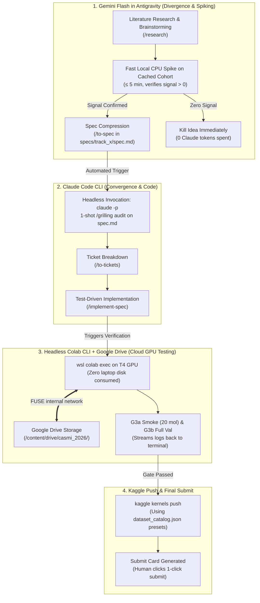

# Autonomous Research & Code Execution: Colab CLI + Google Drive Integration Plan

> **File Location**: [`specs/specs_scratch/colab_drive_cli_integration.md`](file:///e:/ENVEDA_casmi/specs/specs_scratch/colab_drive_cli_integration.md)  
> **Target Track**: Cross-Track Autonomous Execution (Track 1 Retrieval, Track 2 Novel, Track 3 MS Simulators, specs_scratch)  
> **Competition**: Enveda CASMI 2026 — Molecule ID From LC-MS/MS Mass Spectra (MRR@25 on InChIKey14)  
> **Status**: Verified & Operational (Ticket 0 PASS on 2026-10-10) — See [`specs/specs_scratch/colab_spike_result.md`](file:///e:/ENVEDA_casmi/specs/specs_scratch/colab_spike_result.md)  

---

## 1. System Vision & Multi-Agent Architecture

The goal of this system is to establish a **low-token, zero-local-storage autonomous research and execution pipeline** across two specialized AI agents and cloud infrastructure:



### Agent Roles:
1. **Gemini Flash (in Antigravity IDE)**:
   * **Role**: The Divergent Explorer & Hypothesis Tester.
   * Runs unconstrained brainstorming, math derivations, and fast cached data spikes.
   * Uses Matt Pocock's `/to-spec` to compress 50 turns of exploration into a clean 1-page `spec.md`.
2. **Claude Code (Headless CLI)**:
   * **Role**: The Strict Domain Judge & Senior Implementer.
   * Invoked via `claude -p` on the compressed `spec.md`.
   * Enforces hard CASMI rules: +1.45 ppm timsTOF offset, InChIKey14 deduplication, 9h Kaggle offline runtime.
   * Executes `/to-tickets` and `/implement-spec` with zero wasted token context.

---

## 2. Infrastructure: Zero-Local-Disk Cloud Architecture

### The Local Constraint:
* The host laptop has limited local SSD storage. Large files (models, checkpoints, raw datasets) cannot be stored locally.
* **Storage Solution**: All models, datasets, and wheelhouses are stored permanently in Google Drive at `/content/drive/casmi_2026/` (as mapped in [`specs/Dataset_intro/drive_folder_structure.txt`](file:///e:/ENVEDA_casmi/specs/Dataset_intro/drive_folder_structure.txt)).

### The Cloud Compute Solution (Google Colab CLI):
* Google Colab CLI (`google-colab-cli`) bridges the local terminal directly to remote cloud T4/A100 instances.
* Runs on **Windows via WSL2 (Ubuntu)**.
* Remote GPU mounts Google Drive directly over Google's internal datacenter fiber network.
* **Local disk used**: **0 MB**.

---

## 3. Data Mapping: Google Drive to Pipeline Mounts

Reference from [`specs/Dataset_intro/drive_folder_structure.txt`](file:///e:/ENVEDA_casmi/specs/Dataset_intro/drive_folder_structure.txt):

| Google Drive Path (`/content/drive/casmi_2026/`) | Contents & Purpose | Pipeline Equivalent / Kaggle Slug |
| :--- | :--- | :--- |
| `casmi26-pubchem-tier/` | `pc_mass.npy`, `pc_off.npy`, `pc_smiles.npy` (105.8M rows) | `ahmedberatozer/casmi26-pubchem-tier` |
| `casmi26-pubchem-popularity-prior/` | `pc_lsid.npy`, `pc_lpmid.npy`, `pc_np.npy`, `pool_*.npy` | `dmitriigluzdov/casmi26-pubchem-popularity-prior` |
| `casmi26-v2-pool/` | `pool_meta.parquet`, `pool_fp.npy`, `pool_frag_*.npy` | `ahmedberatozer/casmi26-v2-pool` |
| `casmi26-fpnet-full1/` | `fpnet_full1.pt` (FPNet trained on all folds) | `ahmedberatozer/casmi26-fpnet-full1` |
| `casmi26-fp-models-v2/` | `fp_merged_m1.pt`, `fp_single_s2.pt` | `prvsiyan/casmi26-fp-models-v2` |
| `casmi26-offline-rdkit-2026033/` | `rdkit-2026.3.3-cp312-...whl` | `metric/rdkit-2026-3-3-wheel` |
| `_simlib/gate/kaggle_upload/` | `iceberg_worker.py`, wheelhouse/ | `ahmedberatozer/casmi26-iceberg` |
| `madgen/` | `msgym.ckpt`, `canopus.ckpt` | MassSpecGym GLACIER models |
| `casmi26-scratch-pool/` | `pool_mass.npy`, `pool_smiles.parquet`, `pool_npc.parquet` | `syedtoubur/casmi26-scratch-pool` |
| `val_scripts/` | `val.parquet`, `scaffolds.pkl`, `val_key.pkl` | Offline validation benchmark cohort |

---

## 4. The 5-Rung Validation Ladder

Before any code touches a precious daily Kaggle submission slot (5/day), it must climb this ladder:

```
[G1 Static Audit]        --> Automated AST & rule check (PPM offset, InChIKey14, no leakage).
         │
[G2 Local Spike/Unit]    --> Local CPU dry run on 2-5 molecules (tests code execution & metric signal).
         │
[G3a Colab Smoke]        --> Remote T4 GPU via Colab CLI: 20-molecule run with real CUDA (time < 60s).
         │
[G3b Colab Val Cohort]   --> Full 400-molecule validation run on Drive data; must show relative delta ≥ +0.004.
         │
[G4 Kaggle Push & Card]  --> Push via Kaggle CLI with kernel-metadata.json. Submit card generated.
         │
[Human 1-Click Submit]   --> You spend 10s to approve the submission on Kaggle.
```

---

## 5. Execution Plan: Ticket 0 (Colab CLI Viability Spike)

### Objective:
Verify whether `google-colab-cli` in WSL2 can mount Google Drive headlessly and execute a 20-molecule smoke script without interactive browser blocking.

### Step-by-Step Ticket 0 Tasks:

#### Task 0.1: WSL2 & CLI Installation
Inside WSL2 (Ubuntu):
```bash
# Ensure uv or pip is available
pip install --upgrade google-colab-cli

# Verify version and help
colab --help
```

#### Task 0.2: One-Time Google Authentication
```bash
# Authenticate Google account (opens link in browser or pastes OAuth token)
colab auth
```

#### Task 0.3: Provision Remote GPU Instance
```bash
colab new --accelerator T4 -s casmi_runner
```

#### Task 0.4: Drive Mount & Data Verification Script (`test_drive_access.py`)
Run a small remote test script via `colab exec`:
```python
# test_drive_access.py
from google.colab import drive
import os

drive.mount('/content/drive')
drive_root = '/content/drive/MyDrive/casmi_2026'

print("Drive mounted successfully!")
print("Directories found:", os.listdir(drive_root)[:10])

# Verify core files exist
assert os.path.exists(f"{drive_root}/casmi26-pubchem-tier/pc_mass.npy"), "Pubchem tier missing!"
assert os.path.exists(f"{drive_root}/casmi26-v2-pool/pool_meta.parquet"), "v2 pool missing!"
print("All core checkpoints and arrays verified!")
```
Command:
```bash
colab exec -s casmi_runner -f test_drive_access.py
```

#### Task 0.5: 20-Molecule Smoke Test
Execute a real inference smoke test on 20 molecules using the mounted Drive checkpoints, logging timing, memory, and MRR@25 calculation.

#### Task 0.6: Evaluate Fallback
* **If Ticket 0 passes cleanly**: Adopt Colab CLI for all G3a/G3b stages.
* **If Drive requires browser re-auth each time**: Fall back to using Kaggle draft runs (`kaggle kernels push`) with `specs/Dataset_intro/dataset_catalog.json` presets.

---

## 6. Stop Conditions & Deliverables
1. Ticket 0 execution logs captured in `specs/specs_scratch/colab_spike_result.md`.
2. Decision logged in `EXPERIMENTS.md`: Colab CLI confirmed OR Kaggle draft fallback activated.
3. Clean hand-off for ongoing feature pipelines.
