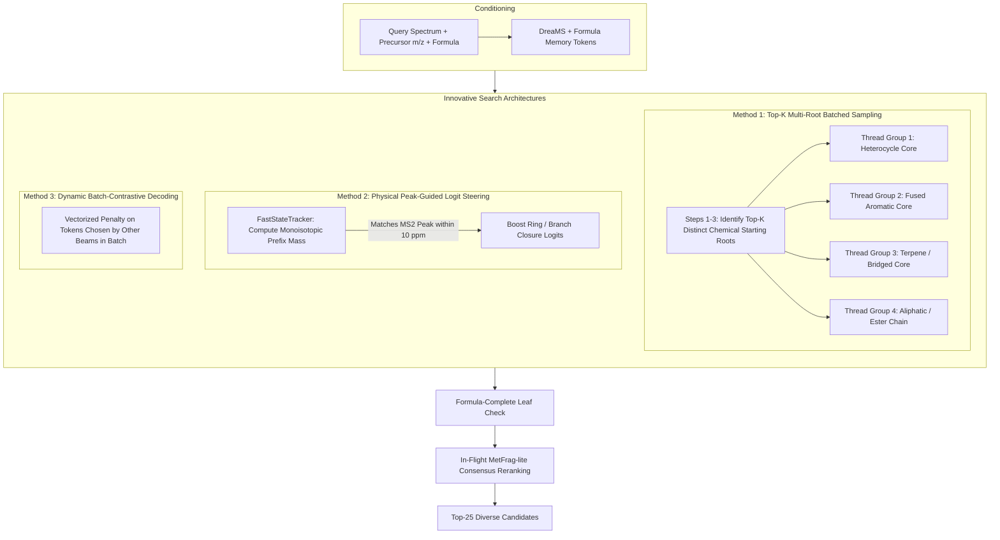

# specs_novel — Innovative Search & Decoding Plan

*Written 2026-09-29. **Amended to v1.1 the same day**, after review against `build/novel_decoder.py`
and the G3 pre-registration. This document outlines the search and generation architectures for the
`DreamsSelfiesDecoder` in `specs_novel`. It explores the trade-offs between beam search, best-first
search, and stochastic sampling, and specifies fully-batched search paradigms that maximize chemical
diversity while minimizing GPU compute.*

---

## 0. v1.1 amendment — what changed and why (read this before §3)

The v1.0 architectures below were reviewed against the actual tracker implementation
(`build/novel_decoder.py:306-327`) and against what G3 actually measures. **Six claims did not
survive.** Where §3 conflicts with this section, **this section wins**; the original text is kept so
the reasoning stays auditable.

1. **Root expansion at step 1 is chemically empty — Method 1 now seeds at depth `L_SEED` = 4.**
   From `<s>` the derivation state is `0`. `Tracker.legal_mask` adds `is_branch` only when
   `state > 1` and `is_ring` only when `state > 0`, so `[Branch1]` — named as a root in §3 Method 1 —
   **is illegal as the first token**, as is every ring token. Worse, `next_atom_state(bond, cap, 0)`
   returns `order == 0` for every bond prefix, so `[C]`, `[=C]` and `[#C]` are **degenerate at
   position 1**. The distinct roots available at depth 1 are just the elements present in the
   formula: 2–4 in practice, not 6. Method 1's own rationale says scaffold topology is set over "the
   first 3 to 6 tokens" — that is right, and it contradicts its own step 1. Seeding is therefore an
   exhaustive masked expansion to depth 4, keeping the top `K_ROOTS` = 8 distinct prefixes.
2. **Ranking the final 25 by cumulative `logp` defeats the metric — selection is `maxmin`.**
   G3 scores top-25 **max** Tanimoto, so returning "the 25 most likely of 256" discards exactly the
   off-mode candidates the multi-root step was built to create. The 25 are chosen by logp-seeded
   greedy MaxMin on Morgan r2/2048, with plain `logp` reported beside it as the ablation.
3. **Method 2 (peak-guided logit steering) is DROPPED, not deferred — it is unsound.** Its prefix
   mass counts heavy atoms only, but SELFIES does not fix the hydrogen count until the leaf (that is
   precisely why plan §3.6's full-formula check does real work). A prefix therefore carries up to
   ~±10 Da of unresolved H, and a ≤ 10 ppm "resonance" window on such a quantity is not a
   well-defined test. Independently, a SELFIES prefix is a *partial derivation*, not a fragment:
   branches open later, and fragment ions come from bond cleavages that do not align with prefix
   boundaries. The calibrated way to use the peaks is `fr` / `sv` **at the leaf** (plan §3.7).
4. **Method 4's in-flight rerank must not touch G3, and one of its premises is factually wrong.**
   G3 compares the decoder against `RandomDeNovo` *given the same formula*; if only our arm is
   reranked, the gate measures the reranker. Also, G3's metrics are **order-invariant** (see 6), so a
   reranker cannot move them except by changing *which* 25 survive. And **MetFrag-lite is not in
   `simsim_common.py`**: `frag_scores`, `explain_score` and `fragment_masses` live in the phase1
   notebook and are spliced in by `build/mk_simple_sim.py:35`, so reusing them is a porting task, not
   an import. The rerank belongs in P4, applied to **both arms**.
5. **Best-first is not inherently unbatched.** §2's "300,000 sequential forward passes" assumes
   node-at-a-time expansion, but the top-`B` frontier can be popped and expanded in one forward pass.
   At this model size (~28 M params, vocab 81, memory ≤ 17 tokens) the bottleneck is not the GPU at
   all: it is `Tracker.push` + `legal_mask` at **19 µs/step in Python** — for B = 256 and L = 171 that
   is ≈ 0.8 s per molecule of pure Python. More *samples* is cheap; more sequential *depth* is not.
   Best-first is therefore deferred to **P4**, where it is compared at equal time, rather than
   rejected.
6. **G3's metrics are order-invariant.** Median top-25 max Tanimoto and exact@25 are a max and a
   membership test over a *set* of 25 — reordering them changes nothing. Ranking decides **P4's**
   MRR@25 and top-1/top-10. This is the structural reason every ranking idea in this document is a P4
   concern.

**What P3 actually runs** (pre-registered in `gate_report.md` → G3): a three-method bake-off at an
**equal candidate budget of N = 256 sequences per molecule** — **A** prefix-seeded batched sampling
(Method 1, corrected), **B** plain masked beam as the **control**, **C** diverse masked beam
(Method 3). The winner is selected on a 300-molecule `dec_val` subset; **G3 is then judged on one run
of that winner on `pseudo_c3`**, so the bake-off cannot inflate the verdict.

---

## 1. Executive Summary & Problem Formulation

### 1.1 The Crux of De Novo Search in Mass Spectrometry
In the Enveda CASMI 2026 challenge, Track B (`specs_novel`) generates candidate molecular structures for **Class 3** (completely novel natural products absent from PubChem/COCONUT). While fine-tuning an autoregressive decoder on frozen DreaMS spectrum embeddings is a standard starting point, **the competitive advantage lies in how the combinatorial chemical search space is traversed**.

Mass spectrometry de novo generation presents an extreme one-to-many inverse problem:
1. **The Formula Constraint**: High-resolution precursor $m/z$ provides the exact candidate chemical formula (e.g. $\text{C}_{18}\text{H}_{22}\text{N}_2\text{O}_4$). The search is strictly hard-constrained by `FastStateTracker` at 19 $\mu\text{s/step}$ so that zero illegal atoms are placed and $</s>$ is legal only when the formula is exactly satisfied.
2. **The Metric Objective**: Gate **G3** evaluates:
   $$\Delta \text{Median Top-25 Max Tanimoto} \ge +0.10 \quad \text{vs. } \text{RandomDeNovo}$$
   Gate **G4.0** (Kill-Switch) evaluates:
   $$\text{Oracle-Formula Exact@25} \ge 1.0\% \quad \text{on } pseudo\_c3$$

Because the target metric is the **maximum similarity across the top 25 candidates**, generation quality depends fundamentally on **scaffold diversity**:
- 25 near-identical isomers of an incorrect core scaffold will all score low Tanimoto ($\sim 0.25$).
- 25 diverse candidates spanning distinct natural product scaffold families (e.g. flavonoids, alkaloids, terpenes, polyketides) maximize the probability that at least one candidate matches the true scaffold topology ($\text{Tanimoto} \ge 0.60$).

---

## 2. Failure Modes of Standard Approaches

| Approach | Mechanism | Critical Failure Mode | Compute Profile |
|---|---|---|---|
| **Unbatched Best-First DFS** (`plan.md §4.3`) | Priority queue (min-heap on $-\sum \log p$) | **Latency comes from sequential expansion, not from the GPU** (corrected in §0.5): node-at-a-time expansion forgoes batching, and per-node KV-cache tensors complicate memory management. But the frontier *can* be popped top-`B` and expanded in one pass, and at this model size the real cost is `Tracker` Python overhead at 19 µs/step. **Deferred to P4**, not rejected. | Slow only if left unbatched |
| **Standard Masked Beam Search** (`plan.md §4.3 fallback`) | Top-$B$ synchronous beam | **Severe Beam / Scaffold Collapse**: At steps $t=1..4$, high-probability local motifs (e.g. benzene ring or alkyl chains) dominate the top $B$ paths. All beams collapse into the identical core scaffold, varying only by peripheral functional groups. `RandomDeNovo`'s independent random graphs can defeat collapsed beams on Max Tanimoto. | Fast, fully batched (~1–2s per molecule) |
| **Naive High-Temperature Sampling** | Multinomial sampling with high $T$ | **Chemical Implausibility**: Generates physically unstable, chemically absurd molecules (peroxide bonds, strained 3-membered rings, unnatural heteroatom clusters) that have near-zero natural product likelihood. | Blazing fast (<0.2s per molecule) |

---

## 3. Four Innovative Search Architectures

To resolve the tension between scaffold diversity, chemical plausibility, and GPU batching efficiency, we propose four distinct, innovative search architectures.



---

### Method 1: Top-$K$ Multi-Root Batched Sampling (The Scaffold-Seeded Approach)
*P3 bake-off **arm A**, corrected per §0.1 and §0.2 — seeding is at depth `L_SEED` = 4, not depth 1,
and the final 25 are selected by `maxmin`, not by cumulative `logp`.*

#### Chemical Rationale
In SELFIES, the first 3 to 6 tokens dictate the global scaffold topology. If the search explores multiple distinct, high-probability opening motifs, it is mathematically guaranteed to generate diverse scaffold families while remaining completely grounded in the mass spectrum.

#### Algorithmic Formulation
1. **Prefix Expansion (to depth $L_{\text{SEED}} = 4$)** — *corrected, §0.1. The original depth-1
   version is unusable: `[Branch1]` and every ring token are illegal at position 1, and `[C]` /
   `[=C]` / `[#C]` are degenerate there, so at most 2–4 distinct roots exist.*
   - Exhaustively expand the masked tree to depth $L_{\text{SEED}} = 4$. The branching factor under
     `Tracker.legal_mask` is small in the early steps, so this is a handful of batched forward passes.
   - Keep the top $K_{\text{ROOTS}} = 8$ **distinct prefixes** by cumulative $\log p$. Depth 4 is
     where ring-opening and branch structure first appear, so these prefixes differ in scaffold
     topology rather than only in element identity.
2. **Synchronous Batched Rollout**:
   - Allocate $M$ parallel sampling trajectories to each of the $K$ roots (e.g., $K = 6 \text{ roots} \times M = 8 \text{ trajectories} = 48 \text{ parallel candidates}$).
   - Stack all 48 trajectories into a **single static PyTorch tensor** of shape `[48, t, D]`.
   - At each step $t \ge 2$:
     - Compute forward pass for all 48 sequences in parallel.
     - Apply `FastStateTracker.legal_mask` (setting illegal tokens to $-\infty$).
     - Sample the next token using a mild temperature $T \in [0.65, 0.75]$ with top-$p$ nucleus filtering ($p = 0.90$).
3. **Termination & Selection**:
   - When a sequence emits `</s>`, it is checked for full formula compliance (including implicit H count) and transferred to the candidate pool.
   - Deduplicate candidates by `InChIKey14`.
   - **Select** 25 of the survivors by `maxmin` (logp-seeded greedy MaxMin on Morgan r2/2048), *not*
     by $\sum \log p$ — §0.2. Plain $\sum \log p$ is reported beside it as the ablation.

#### Advantages
- **Scaffold Diversity**: forces $K_{\text{ROOTS}} = 8$ distinct depth-4 lineages, which is what
  prevents the collapse that arm B (plain beam) is included to measure.
- **100% Batched GPU Compute**: Zero sequential loops or heap manipulation; runs in **$\approx 250\text{--}350\text{ ms}$ per molecule** on a T4 GPU.
- **Minimal Code Complexity**: Easily implemented in ~50 lines of clean PyTorch code inside `build/novel_decoder.py`.

---

### Method 2: Physical Peak-Guided Logit Steering (Substructure Mass Resonance)
> **DROPPED in v1.1 — unsound, see §0.3.** The prefix mass counts heavy atoms only, but SELFIES does
> not fix the hydrogen count until the leaf, so the quantity being matched to a peak carries up to
> ~±10 Da of unresolved H and a 10 ppm window on it is meaningless. Separately, a SELFIES prefix is a
> partial derivation, not a cleavage product. Peaks are used at the **leaf** instead (`fr` / `sv`,
> plan §3.7). The text below is retained only as a record of the rejected design.

#### Chemical Rationale
In tandem mass spectrometry (MS/MS), collision-induced dissociation (CID) breaks the precursor molecule into stable fragment ions. Every intense peak in the experimental spectrum corresponds to a physical substructure that formed in the instrument. Standard language models decode blindly, unaware of whether their growing prefix matches any experimental peak.

#### Algorithmic Formulation
1. **Prefix Mass Tracking**:
   The `FastStateTracker` maintains the counts of heavy atoms used so far $[C, N, O, P, S, F, Cl, Br, I]$. At each step $t$, compute the prefix monoisotopic heavy mass:
   $$M_{\text{prefix}}(t) = \sum_{e} \text{count}_e(t) \cdot \text{mass}(e)$$
2. **Resonance Condition**:
   Check whether the prefix mass matches an experimental fragment peak $m/z_p \in \text{Peaks}_{\text{query}}$ within the instrument mass tolerance ($\le 10\text{ ppm}$):
   $$\Delta_{\text{min}}(t) = \min_{p} \frac{|M_{\text{prefix}}(t) + m_{\text{adduct\_frag}} - m/z_p|}{m/z_p} \times 10^6$$
3. **Dynamic Logit Steering**:
   If $\Delta_{\text{min}}(t) \le 10\text{ ppm}$, the prefix has formed a plausible substructure that directly explains an observed peak. Modulate the output logits $z(w)$ before sampling:
   $$\tilde{z}(w) = z(w) + \gamma \cdot \mathbb{I}(w \in \mathcal{T}_{\text{closure}})$$
   where $\mathcal{T}_{\text{closure}} = \{ \texttt{[Ring1]}, \texttt{[Ring2]}, \texttt{[Branch1]}, \texttt{[=O]}, \texttt{</s>} \}$ and $\gamma \in [0.5, 1.5]$ is the resonance reward.

#### Advantages
- **Physics-Informed Generation**: Actively guides the generator toward natural product topologies that explain the physical fragmentation spectrum.
- **Vectorized Lookup**: Implemented via a pre-sorted 1D peak tensor lookup on GPU with negligible latency overhead ($< 15\text{ ms}$).

---

### Method 3: Dynamic Batch-Contrastive Decoding (Cross-Beam Repetition Penalty)
*P3 bake-off **arm C**, with `BEAM` = 256 and `ALPHA_DIVERSE` = 0.6. The **unpenalised** $\log p$ must
be carried alongside the penalised score, because P4 orders novel candidates on `logp`.*

#### Concept
Rather than penalizing token repetition within a single sequence, penalize **scaffold redundancy across parallel candidate beams** in the same batch.

#### Algorithmic Formulation
For a batch of $B = 32$ parallel beams:
1. At step $t$, calculate the token frequency across all other $B-1$ beams:
   $$\text{Freq}_i(w) = \frac{1}{B-1} \sum_{j \neq i} \mathbb{I}(w_{j, t} == w)$$
2. Apply a dynamic contrastive penalty to the logits:
   $$\tilde{z}_i(w) = z_i(w) - \alpha \cdot \text{Freq}_i(w) \cdot \mathbb{I}(w \in \mathcal{T}_{\text{scaffold}})$$
   where $\mathcal{T}_{\text{scaffold}}$ consists of ring tokens and branch tokens, and $\alpha \approx 0.4\text{--}0.8$.
3. When Beam 1 and Beam 2 commit to building a 6-membered aromatic ring, the penalty automatically nudges Beams 3 and 4 toward alternative heterocyclic or branched topologies.

#### Advantages
- Preserves the deterministic nature of beam search while dynamically preventing beam collapse.
- 100% vectorized in PyTorch using `torch.bincount` or `scatter_add`.

---

### Method 4: Two-Tier Speculative Search & Consensus Reranking
*P4 and P5 only — **never inside G3**, see §0.4: G3's metrics are order-invariant, and reranking only
our arm would measure the reranker rather than the decoder. In P4 the rerank is applied to **both**
arms, on `pseudo_c3` only (A-G1.1 bars `ts_dec` from every ICEBERG-based metric).*

#### Concept
Language models are notoriously overconfident on short, generic sequences. Instead of relying solely on raw sequence log-probability $\sum \log p$ to determine the final top-25 ranking, use a **two-tier speculative pipeline**:

1. **Tier 1 (High-Entropy Generation)**:
   - Use Method 1 (Multi-Root Batched Sampling) to generate $N = 64\text{ to }96$ candidate sequences in a single batched pass (~300 ms).
   - Filter by exact hydrogen formula match and strip stereo to obtain $M \approx 40\text{--}60$ unique valid candidate structures.
2. **Tier 2 (In-Flight MetFrag-lite Consensus Reranking)**:
   - Run our lightweight vectorized fragmenter across the $M$ candidates against the experimental
     query peaks. **Note (§0.4): MetFrag-lite is *not* in `simsim_common.py`** — `frag_scores`,
     `explain_score` and `fragment_masses` live in the phase1 notebook and are spliced in by
     `build/mk_simple_sim.py:35`, so reusing them in a Colab notebook is a porting task.
   - Compute the joint ranking score:
     $$\text{Score}(m) = \log P_{\text{DreaMS}}(m) + \beta \cdot \text{FragmentScore}(m, \text{Spectrum}) + \lambda \cdot \text{Plausibility}(m)$$
   - Return the top 25 highest-scoring structures.

---

## 4. Phase-by-Phase Roadmap Integration

| Phase | Milestone | Search Architecture to Use | Rationale |
|---|---|---|---|
| **Phase 3** | Decoder Training & Gate G3 | **Bake-off at equal budget N = 256: arm A (Method 1, depth-4 seeded) vs arm B (plain masked beam, control) vs arm C (Method 3)** | - De-risks Phase 3 with clean, batched code.<br>- Arm B is the control that shows whether diversity engineering earns anything.<br>- Winner selected on a 300-molecule `dec_val` subset; G3 judged once on `pseudo_c3`. |
| **Phase 4** | Offline Search Optimization & Gate G4.0 (Kill Switch) | **P3 winner vs batched best-first frontier, at equal time** | - Best-first deferred here (§0.5), batched rather than node-at-a-time.<br>- Tier 2 rerank tested on **both arms**, `pseudo_c3` only.<br>- Method 2 is dropped (§0.3).<br>- Evaluates exact@25 on `pseudo_c3` and `ts_dec`. |
| **Phase 5** | Kaggle Submission Worker | **Optimized Two-Tier Batched Worker** | - Runs completely offline on GPU 1 (T4).<br>- Takes $< 0.4\text{s}$ per molecule.<br>- Complete test inference (500 molecules) finishes in $< 4\text{ minutes}$ of the 9-hour budget. |

---

## 5. Architectural Interfaces for `build/novel_decoder.py`

*Amended to the real P3 signatures (v1.1). `peaks` is gone with Method 2 (§0.3), and generation is
separated from **selection**, because the search returns ~`N_CANDIDATES` survivors and a distinct
selector cuts them to 25 (§0.2).*

```python
# generation -- three arms, one signature, all returning (smiles, logp) for every formula-complete leaf
def search_prefix_seeded(model, memory, formula, *, l_seed=4, k_roots=8, m_rollout=32,
                         temperature=0.7, top_p=0.90) -> list[tuple[str, float]]   # arm A
def search_masked_beam(model, memory, formula, *, beam=256) -> list[tuple[str, float]]        # arm B
def search_diverse_beam(model, memory, formula, *, beam=256, alpha=0.6) -> list[tuple[str, float]]
    # arm C; returns the UNPENALISED logp, so P4 can order novel candidates on it

# memory (plan section 3.5) -- no positional encoding: the spectra are a set
def build_memory(embs, adducts, ces, formula) -> torch.Tensor    # (k+1, D_MODEL)

# selection -- what actually decides G3, since the metric is a max over 25
def select_top25(cands: list[tuple[str, float]], mode: str = "maxmin") -> list[tuple[str, float]]
    # "maxmin": logp-seeded greedy MaxMin on Morgan r2/2048.  "logp": plain sort (the ablation).
```

Every arm drives `Tracker.legal_mask()` / `Tracker.push()` from the P0 part of
`build/novel_decoder.py`; none reimplements the SELFIES grammar or the atom counting. Leaves are
checked against the **full** formula including H and deduped by ik14 before selection.

---

## 6. Summary Recommendation for Phase 3 Execution

*Superseded by §0 and by `gate_report.md` → G3, which is the authority. Retained for the record.*

1. **Run all three arms** — A (Method 1, seeded at depth `L_SEED` = 4), B (plain masked beam,
   control), C (Method 3) — at an **equal candidate budget of `N_CANDIDATES` = 256**, so compute is
   matched by construction.
2. **Do not run unbatched best-first in Phase 3.** It moves to P4 in *batched* form (§0.5).
3. **Pre-registered search parameters** (`gate_report.md` → G3):
   - `N_CANDIDATES` 256; arm A = `L_SEED` 4 × `K_ROOTS` 8 × `M_ROLLOUT` 32; arms B and C `BEAM` 256.
   - `TEMPERATURE` $T = 0.7$, `TOP_P` $= 0.90$; `ALPHA_DIVERSE` $= 0.6$ for arm C.
   - `SELECT_MODE` = `"maxmin"` primary, `"logp"` reported beside it.
   - Hard formula constraint via `Tracker.legal_mask`; leaf check on the **full** formula including H.
4. **Selection rule:** winner chosen on a 300-molecule `dec_val` subset, G3 judged **once** on that
   winner on `pseudo_c3`. The losing arms' `pseudo_c3` numbers are never produced.
