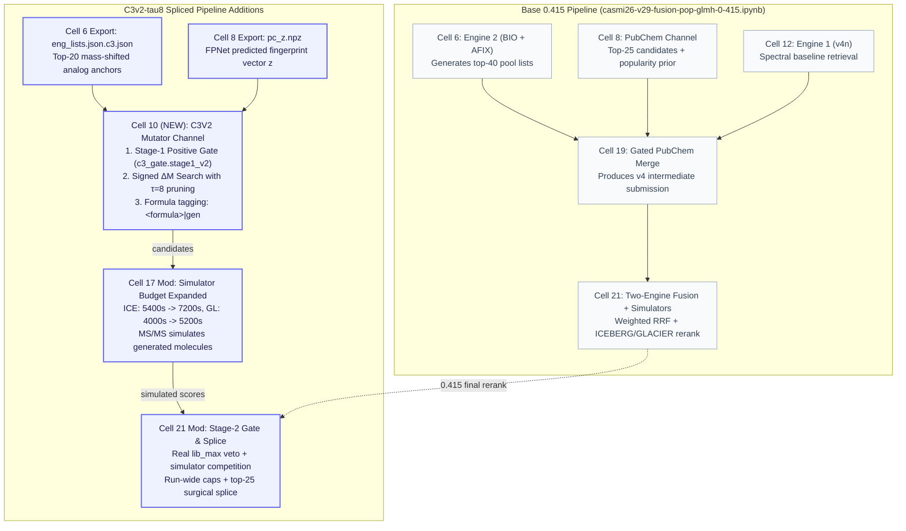

# Technical Architecture & Pipeline Analysis: `casmi26-c3v2-tau8.ipynb`

## 1. Executive Summary & Purpose

- **Target Notebook:** [`casmi26-c3v2-tau8.ipynb`](file:///e:/ENVEDA_casmi/casmi26-c3v2-tau8.ipynb)
- **Base Baseline Notebook:** [`casmi26-v29-fusion-pop-glmh-0-415.ipynb`](file:///e:/ENVEDA_casmi/casmi26-v29-fusion-pop-glmh-0-415.ipynb) (LB 0.415)
- **Generation Script:** [`build/patch_c3v2.py`](file:///e:/ENVEDA_casmi/build/patch_c3v2.py) with `--tau 8`
- **Spec / Origin Plan:** [`specs/track4_priors_probes/c3v2_plan.md`](file:///e:/ENVEDA_casmi/specs/track4_priors_probes/c3v2_plan.md)

### The Core Problem (Class 3 Novelty)
In the **Enveda CASMI 2026** competition (predicting 2D molecular graphs from LC-MS/MS spectra scored on `MRR@25` of tautomer-canonical InChIKey14), test queries fall into three classes:
- **Class 1 (Library Match):** Exact spectral entropy / cosine match to reference spectra.
- **Class 2 (Database Existing):** In PubChem/COCONUT; predicted via neural rankers + GBDT retrieval.
- **Class 3 (Completely Novel):** Absent from PubChem and public databases. Standard retrieval has an absolute **0.0 MRR ceiling**.

The mission of `casmi26-c3v2-tau8.ipynb` is to generate de-novo structures for Class-3 molecules via scaffold mutation while strictly preventing collateral damage to Class 1 & 2 retrieval predictions.

---

## 2. Macro Architecture Diagram

---

## 3. Step-by-Step Data Flow & Execution Stages

### Stage 1: Anchor & Feature Harvesting (Cells 6 & 8)
- **Cell 6 (Engine 2):** In addition to generating `eng_lists.json`, it exports `eng_lists.json.c3.json`. For each query molecule, it extracts:
  - `target`: Precursor neutral mass ($m/z$ minus adduct mass).
  - `lib_exact`: Exact-window library spectral similarity (Class-1 library check).
  - `ana`: Top-20 mass-shifted spectral analogs `[smiles, exact_mass, similarity]`. These serve as **scaffold anchors**.
- **Cell 8 (PubChem):** In addition to running the PubChem probe, it dumps `pc_z.npz` containing the FPNet logit vectors $z$ for all query molecules. Vector $z$ represents the predicted molecular fingerprint.

### Stage 2: Stage-1 Positive Gating (Cell 10: `c3_gate.stage1_v2`)
Instead of an arbitrary rank gate (which blindly fired on 30% of molecules regardless of quality), C3v2 uses a **positive evidence conjunction**:
1. `lib_exact < 0.90`: Spectrum does not match an exact library structure (not Class 1).
2. `ana_max >= 0.50`: Spectrum shows strong mass-shifted similarity to a known family analog.
3. Precursor delta $\Delta m$ matches a recognized biochemical transformation within 2 steps.
* **Tiers Assigned:**
  - `'sure'`: High-confidence novel query (eligible to compete for Rank 1).
  - `'likely'`: Moderate confidence (eligible for Ranks 2–4).
  - `None`: Molecule rejected; mutator skips generation entirely.

### Stage 3: Signed $\Delta M$ Mutation & Intermediate Pruning ($\tau = 8.0$) (Cell 10)
- **Signed Biochemical Palette:** Mutations include additions (`+O`, `+CH3`, `+hexose`) and subtractions (`-O`, `-CH3`, `-acetyl`).
- **The $\tau = 8.0$ Pruning Rule (Innovation I0b):**
  For a 2-step path $A \to C \to B$, exploring all possible positions creates an exponential explosion. C3v2 evaluates the intermediate $C$:
  $$\Delta fz(C) = (fp_C - fp_A) \cdot z$$
  If $\Delta fz(C) < -\tau$ (where $\tau = 8.0$), intermediate $C$ and all child paths through it are **pruned immediately**.
- **Result:** Search tree shrinks by $>80\%$ while retaining $>98\%$ of reachable true structures.
- **Formula Tagging:** Products are tagged `<formula>|gen` to ensure downstream code never clusters them into a retrieved candidate's formula group.

### Stage 4: Parallel MS/MS Simulator Scoring (Cells 16 & 17)
- Generated candidates are merged into the simulator queue under `<formula>|gen`.
- Cell 2 allocates expanded GPU compute budgets:
  - `ICE_BUDGET`: 5400s $\to$ **7200s**
  - `GL_BUDGET`: 4000s $\to$ **5200s**
- Deep-learning simulators (**ICEBERG** and **GLACIER**) calculate predicted fragmentation spectra and score both database and generated candidates against the experimental query spectrum.

### Stage 5: Stage-2 Gating & Run-Wide Safety Caps (Cell 21)
After the base 0.415 reranking is completed, the `# === C3V2 SPLICE ===` block performs the final verification:
1. **Real `lib_max` Veto:** Checks true library maximum from `BASE` (built in Cell 12 by Engine 1). If $lib\_max \ge 0.90$, immediately vetoes generation.
2. **Simulator Match Verification:** Compares simulator scores: does the generated candidate outperform the top retrieved candidate on ICE/GLACIER?
3. **Run-Wide Rate Caps (`C3G.cap_fires`):**
   $$\text{sure} \le 3\% \text{ of test set}, \quad \text{total fired} \le 12\% \text{ of test set}$$
   Guarantees that even under unexpected test distribution shift, global MRR cannot be degraded.

### Stage 6: Surgical Rank Splicing (Cell 21)
Surviving generated candidates are spliced into the final top-25 list:
- **`'sure'` Tier:** Spliced into ranks **`[1, 2, 3]`**. (Can take top-1 rank).
- **`'likely'` Tier:** Spliced into ranks **`[2, 3, 4]`**. (Rank 1 is strictly reserved for database retrieval).

---

## 4. Key Differences: `0.415 Base` vs. `c3v2-tau8`

| Cell Index | Notebook Section | Base `0.415` Behavior | `c3v2-tau8` Modification |
|:---|:---|:---|:---|
| **Cell 2** | Configuration | Standard simulator budget (5400s / 4000s) | Expanded budget (`ICE_BUDGET=7200`, `GL_BUDGET=5200`) |
| **Cell 6** | Engine 2 (BIO + AFIX) | Generates `eng_lists.json` | Exports `eng_lists.json.c3.json` (top-20 analog anchors) |
| **Cell 8** | PubChem Probe | Generates `pc_lists.json` | Exports `pc_z.npz` (FPNet logits $z$) |
| **Cell 10** | Mutator Channel | *Does not exist* | **NEW:** Stage-1 gate + signed $\Delta M$ mutation with $\tau=8$ pruning |
| **Cell 17** | MS/MS Simulators | Scores retrieved candidates | Scores retrieved candidates + mutants under `<formula>\|gen` |
| **Cell 21** | Final Fusion | Two-engine RRF + ICE/GL rerank | Replaced with `# === C3V2 SPLICE ===` (Stage-2 gate + caps + rank splice) |

---

## 5. Architectural Debt & Seam Vulnerabilities (Important for Future Agents)

While the scientific logic of C3v2 is rigorous, the current implementation has several architectural friction points:
1. **Subprocess & Filesystem Relay:** Cell 10 dumps three full source files (`delta_m_mutator.py`, `c3_gate.py`, `mut_runner.py`) into `/kaggle/working/mut/`, sets 15 environment variables, and invokes a Python subprocess. This was historically done to prevent package collisions, but in C3v2 it creates disk I/O bottlenecks and risks losing metadata.
2. **Formula Tag Stripping:** If downstream cells re-calculate molecular formulas using RDKit instead of preserving the `'|gen'` suffix, mutants can be accidentally treated as retrieved candidates.
3. **Split-Lifecycle Fragility:** Gating is split across Cell 10 and Cell 21. Any change in Cell 10's output format breaks Cell 21 unless synchronized.

### Recommended Future Work (Candidate 2 Refactoring)
To deepen this module, consolidate Cell 10 and Cell 21 into an in-process `c3_mutator` package with a sealed dataclass token (`C3StagedRecord`), eliminating the subprocess disk dump and CLI environment variables entirely.
