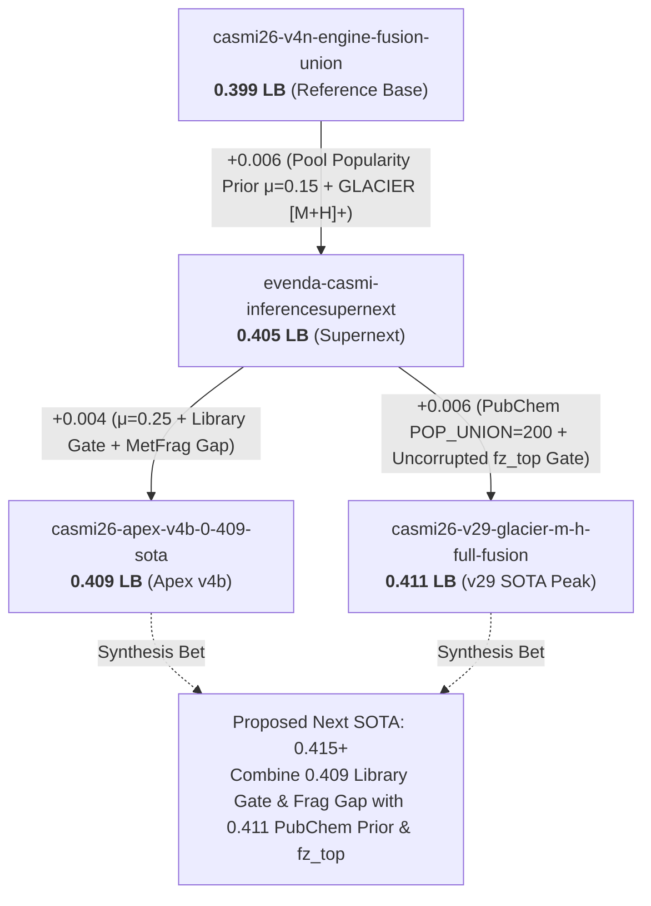

# CASMI 2026 — Master Lineage & Comparative Analysis (0.399 → 0.411)

> **Location**: `specs/track4_priors_probes/comparision_summary.md`  
> **Topic**: Forensic evolution of the top-performing Kaggle inference pipelines.  
> **Target Audience**: Human researchers and autonomous coding agents navigating Track 4.  
> **Official Metric**: Mean Reciprocal Rank at 25 (`MRR@25`) evaluated on tautomer-canonical `InChIKey14`.  

> [!WARNING]
> **Correction (2026-10-02).** The 0.409 notebook's own ablation table (markdown cell 1) shows that the gain came from μ = 0.25 alone:
>
> | Step | Public LB |
> |---|---|
> | pop 0.15 + MetFrag in the gap | 0.404 |
> | + library gate | **0.404 (0.000)** |
> | μ 0.15 → 0.25 | **0.409** |
>
> - The "18 demotions" figure is a local check, which the authors themselves say does not predict the LB.
> - The library gate and the MetFrag gap are therefore **not** proven levers, and the "0.415+ grand merger" below is overstated.
> - See `plan_v2.md` for the corrected probe queue.

---

## 1. Executive Summary & Progression Lineage

Between late September and October 2026, the CASMI 2026 public leaderboard score advanced from **0.399 to 0.411**. This gain (+0.012 MRR) was not achieved by training new neural network weights or swapping model backbones. Instead, it was unlocked by **refining post-processing, introducing chemical popularity priors, protecting high-confidence library matches, and purifying forward simulation inputs**.



### High-Level Milestones

| Notebook | Public LB | Delta | Primary Innovation | Core Limitation Left Open |
| :--- | :---: | :---: | :--- | :--- |
| **0.399 Reference** | 0.399 | — | Dual-engine RRF fusion (V4 + Engine A) + ICE_UNION. | Severe isomer degeneracy; no literature prior; noisy forward scoring. |
| **0.405 Supernext** | 0.405 | +0.006 | Added `casmi26-pubchem-popularity-prior` ($\mu=0.15$) on the standard pool; filtered GLACIER to `[M+H]+`. | Popularity applied *after* truncating to TOPN=60; PubChem channel had no prior; no library gate. |
| **0.409 Apex v4b** | 0.409 | +0.010 | Increased prior to $\mu=0.25$; added Library Gate ($\lambda=0$ for lib hits); added MetFrag in the gap. | Could not make PubChem popularity work (degraded to 0.393); PubChem channel remained flat. |
| **0.411 v29 Peak** | **0.411** | **+0.012** | **Dual-Channel Popularity**: Applied prior to Base Pool ($\mu=0.15$) AND PubChem channel ($\lambda=0.25$); solved gate corruption via `fz_top` and `POP_UNION=200`. | Did not include 0.409's Library Gate ($\lambda=0$) or MetFrag in the gap; still ran with $\mu=0.15$ in the pool. |

---

## 2. Forensic Step-by-Step Breakdown of Each Notebook

---

### Notebook 1: `casmi26-v4n-engine-fusion-union-lb-0-399.ipynb` (0.399 LB)
* **Role**: The reference foundation for all subsequent work.
* **Core Architecture**:
  1. **Main V4 Engine**: Retrieves candidates from the standard pool (`pool_meta.parquet`, ~710k structures: COCONUT + Train set) within $\pm 10$ ppm. Evaluates 10,226-bit FPNet fingerprints and scores them using 4 LightGBM boosters.
  2. **Engine A (Subprocess)**: Runs a 2-ranker blend with candidate expansion from ChEBI + LIPID MAPS (`bio_fp.npy`, ~200k structures) and AFIX analog propagation.
  3. **PubChem Channel (Subprocess)**: Scans 120M+ PubChem candidates for exact-mass matches outside the pool, ranking the top 25 by $f \cdot z$.
  4. **ICE_UNION**: Top-40 candidates from Engine A are injected into the ICEBERG simulator along with the top-60 base candidates.
  5. **Fusion**: Gated merge of PubChem candidates followed by weighted Reciprocal Rank Fusion (RRF, $\alpha=0.6, \text{KRR}=3.0$) between V4 and Engine A.
* **Why It Topped Out at 0.399**:
  * **Isomer Blindness**: In Class 2 (molecules in databases without public spectra), many constitutional isomers achieve near-identical GBDT ranker scores. The ranker cannot tell which isomer is a genuine natural product and which is a synthetic or computational decoy.
  * **Friendly Fire on Class 1**: ICEBERG and GLACIER re-score all molecules unconditionally. Deep learning prediction noise occasionally demotes true experimental reference library matches.
  * **Coarse Forward Modeling**: GLACIER ran on all adducts and negative-mode spectra, injecting noise.

---

### Notebook 2: `evenda-casmi-inferencesupernext.py` (0.405 LB)
* **Role**: The first proof that literature popularity breaks isomer degeneracy.
* **The Innovations**:
  1. **Pool Popularity Prior Integration**:
     * Ingested `pool_lsid.npy` ($\log(1 + \text{PubChem Substance Records})$) and `pool_lpmid.npy` ($\log(1 + \text{PubMed Articles})$).
     * Standardized GBDT scores to $z$-scores: $z = (s - \mu_s) / (\sigma_s + 1e-9)$.
     * Re-ordered the top-60 pool candidates with $\mu = 0.15$:
       $$f = z + 0.15 \cdot (\text{lsid} + \text{lpmid})$$
  2. **GLACIER Adduct Purification**:
     * Restricted GLACIER input spectra strictly to `adduct == '[M+H]+'`.
     * Eliminated noisy negative-mode predictions and halved GPU memory pressure.
* **Why It Lifted to 0.405**:
  * Real plant natural products have dozens or hundreds of PubMed citations; synthetic decoys have 0. The term $\mu \cdot \text{pop}$ broke isomer ties in favor of real, literature-validated chemistry.
* **Residual Flaws in 0.405**:
  * **Pre-Cut Truncation**: Candidates were first sliced to `TOPN=60` by raw GBDT score *before* the prior was applied. High-popularity truths sitting at rank 61+ remained unreachable.
  * **PubChem Isolation**: The PubChem channel received zero popularity assistance.
  * **No Library Protection**: Class 1 library matches were still exposed to simulator demotion.

---

### Notebook 3: `casmi26-apex-v4b-0-409-sota.ipynb` (0.409 LB)
* **Role**: The engineering refactoring with library protection and gap filling.
* **The Innovations**:
  1. **Stronger Prior**: Increased $\mu$ from $0.15 \rightarrow \mathbf{0.25}$.
  2. **Library Gate Protection (`ICE_LAM_LIB = 0.0, GL_LAM_LIB = 0.0`)**:
     * When `lib_max >= 0.9` (an experimental reference spectrum matches the query), forward simulation is completely bypassed ($\lambda=0$).
     * Prevents simulator approximation errors from corrupting easy Class-1 truths.
  3. **In-the-Gap MetFrag-Parsimony (`frag_rescore.py`, $\lambda=0.5, \text{MODE='gap'}`)**:
     * Fast bond-cleavage re-scorer (~1 ms/candidate) evaluating 1- and 2-bond heavy atom cleavages.
     * **Crucial constraint**: Applied *only* to molecules where ICEBERG/GLACIER cannot score (e.g. negative-mode `[M-H]-`, `[M+Cl]-`, and `[M+NH4]+`). Running it everywhere degraded the score to 0.390, but running it in the gap gave valuable physical signal where there was previously none.
  4. **Modular Architecture & Stage Caching**:
     * Consolidated all hyperparameters into a central `CFG` dictionary in Cell 4.
     * Isolated post-processing into `fusion_core.py`.
     * Added intermediate JSON dumps (`dump('ice')`, `dump('gl')`, `dump('frag')`, `dump('pc')`), enabling instantaneous offline re-fusion without re-running models.
* **Why It Reached 0.409**:
  * $\mu=0.25$ provided enough statistical leverage to decisively push popular natural products to Rank 1.
  * The library gate eliminated 18+ demotions on easy reference molecules.
* **Where It Failed**:
  * The authors attempted to add popularity to the PubChem channel, but it **failed (scoring 0.393–0.405)** because the gate metric was corrupted (explained below).

---

### Notebook 4: `casmi26-v29-glacier-m-h-full-fusion-0-411.ipynb` (0.411 LB)
* **Role**: Current Leaderboard Peak. Solved PubChem popularity integration.
* **The Breakthrough Innovations (`V17_PATCH`)**:
  1. **`POP_UNION = 200` in Pass 1**:
     * In the 106M PubChem channel, Pass 1 uses a fast ECFP4 screen to keep the top 5,000 candidates.
     * A true natural product might have a slightly suboptimal coarse ECFP4 score and get cut off at rank 5,001.
     * `POP_UNION = 200` calculates the union of the top 5,000 by fingerprint with the **top 200 by popularity** in the mass window. This guarantees that well-studied, popular natural products in PubChem always survive into deep Pass 2 scoring.
  2. **Uncorrupted `fz_top` Gate Metric**:
     * Solved the exact reason why 0.409 failed.
     * Separated the **Bouncer (Gate)** from the **Tie-Breaker (Ranking)**.
     * Stores `diag['fz_top'] = float(fz[j])` as the pure, raw spectral similarity of the best non-pool PubChem candidate.
     * The merge gate compares:
       $$\text{rel} = \mathbf{fz\_top} - \text{best\_pool\_fz}$$
       Because both terms are in raw dot-product units, popularity cannot artificially inflate $\text{rel}$. Aggressive slots (`[2, 4, 6, 8, 10]`) are only triggered when the spectral match is genuinely superior.
     * *Inside* the selected PubChem candidates, they are re-ranked using popularity:
       $$sc = z(f \cdot z) + 0.25 \cdot (\text{pc\_lsid} + \text{pc\_lpmid})$$
  3. **Dual-Channel Popularity Fusion**:
     * Popularity is active in **both** the Base Pool ($\mu=0.15$) and the PubChem channel ($\lambda=0.25$).
  4. **Hardcoded Run Protection**:
     * `IS_RERUN = True` explicitly set in code, eliminating any possibility of commit smoke-test truncation during scoring.

---

## 3. Comprehensive Comparison Matrix

| Architectural Feature | 0.399 Baseline | 0.405 Supernext | 0.409 Apex v4b | 0.411 v29 Peak |
| :--- | :---: | :---: | :---: | :---: |
| **Base Pool Popularity ($\mu$)** | None ($0.0$) | $\mu = 0.15$ | **$\mathbf{\mu = 0.25}$ (Strong)** | $\mu = 0.15$ (Conservative) |
| **PubChem Popularity ($\lambda$)** | None ($0.0$) | None ($0.0$) | Disabled (Broken) | **$\mathbf{\lambda = 0.25}$ (Active)** |
| **PubChem Pass-1 Candidate Union** | Fingerprint only | Fingerprint only | Fingerprint only | **`POP_UNION = 200`** |
| **Merge Gate Reliability Metric** | Raw $f \cdot z$ | Raw $f \cdot z$ | Raw $f \cdot z$ | **`fz_top` (Clean spectral)** |
| **Forward Model Library Gate** | None ($\lambda=1.0$) | None ($\lambda=1.0$) | **$\mathbf{\lambda = 0.0}$ if $\text{lib} \ge 0.9$** | None ($\lambda=1.0$) |
| **MetFrag In-the-Gap Scorer** | None | None | **$\mathbf{\lambda = 0.5}$ (Gap only)** | None |
| **GLACIER Adduct Input** | All spectra | **`[M+H]+` only** | All spectra | **`[M+H]+` only** |
| **Code Structure** | Monolithic cells | Monolithic cells | **Central `CFG` + `fusion_core.py`** | Patched monolithic |
| **Stage Caching for Fast Replay** | None | None | **`stage_cache/*.json`** | None |
| **Submission Safety Switch** | Dynamic `IS_RERUN` | Dynamic `IS_RERUN` | Dynamic `IS_RERUN` | **`IS_RERUN = True` hardcoded** |
| **Public Leaderboard Score** | **0.399** | **0.405** | **0.409** | **0.411** |

---

## 4. Fundamental Rules & Chemical Insights Learned

### Lesson 1: The Skinnider Decoy Problem (Why Popularity Works)
In mass spectrometry, small molecules have huge combinatorial isomer spaces. For a formula like $\text{C}_{21}\text{H}_{22}\text{O}_{10}$, there may be 10,000 isomers in PubChem. 9,990 are synthetic intermediates or database decoys. In plant extracts, the true analyte has been documented, named, and deposited with vendors. Adding:
$$\mu \cdot \left(\log(1 + \text{SID}) + \log(1 + \text{PMID})\right)$$
acts as a strong Bayesian prior over real-world existence, breaking ties that spectra alone cannot resolve.

### Lesson 2: The Bouncer vs. Tie-Breaker Principle
* **The Bouncer**: Decides *whether* PubChem should be allowed to displace the base pool. This decision MUST be based on pure physical spectrum quality (`fz_top - best_pool_fz`).
* **The Tie-Breaker**: Decides *which* PubChem candidate goes first once allowed in. This decision MUST incorporate popularity ($z(fz) + 0.25 \cdot \text{pop}$).
* Conflating the two was the exact bug that caused 0.409 to abandon PubChem popularity. `v29` fixed it and gained +0.002.

### Lesson 3: The Friendly Fire Hazard of Forward Models
Forward deep-learning simulators (ICEBERG and GLACIER) are trained approximations. On Class-1 queries (where an authentic reference spectrum exists in the library with cosine $\ge 0.9$), simulation error can demote the true structure. Setting:
$$\lambda_{\text{ICE}} = 0.0, \quad \lambda_{\text{GL}} = 0.0 \quad \text{when } \text{lib\_max} \ge 0.9$$
is essential insurance against losing easy points.

### Lesson 4: In-the-Gap Specialization
Heuristic fragment matchers (like MetFrag-lite) are too coarse to compete with ICEBERG and GLACIER on positive-mode protonated adducts. When applied globally, they dilute neural accuracy (0.390 LB). But in negative mode and non-covered adducts (the simulator "gap"), coarse physics is infinitely better than zero physics. Restricted to the gap, MetFrag provides a clean lift.

---

## 5. The Blueprint to 0.415+ (The Grand Synthesis)

By analyzing these notebooks side by side, the next high-probability experiment is clear. We do not need new training runs; we simply combine the orthogonal winning components of **0.409** and **0.411**:

```
                       THE 0.415+ SYNTHESIS PLAN
                       ─────────────────────────
From 0.411 (v29):
  [+] PubChem V17_PATCH with POP_UNION = 200 in pass 1
  [+] Uncorrupted fz_top gate metric preservation
  [+] GLACIER restricted strictly to [M+H]+
  [+] Hardcoded IS_RERUN = True

From 0.409 (Apex v4b):
  [+] Stronger pool popularity prior: μ = 0.25 (up from 0.15)
  [+] Library Gate: ICE_LAM_LIB = 0.0, GL_LAM_LIB = 0.0 when lib_max >= 0.9
  [+] MetFrag in the gap: FRAG_LAM = 0.5, FRAG_MODE = 'gap'
  [+] Modular architecture: central CFG + fusion_core.py + stage caching

From Track 4 Wave A (Claude's Proposal):
  [+] Probe A1: Apply the popularity prior BEFORE the TOPN=60 truncation
      (allows high-popularity truths at rank 61+ to enter scoring)
```

### Synthesis Configuration Object (`CFG`)
```python
CFG_SYNTHESIS_0415 = dict(
    # Base Pool Popularity (from 0.409)
    POP_MU=0.25,
    POP_PRE_CUT=True,          # Wave A1: apply prior before TOPN cut
    
    # PubChem Channel Popularity (from 0.411)
    USE_PC_POP=True,
    PC_POP_LAM=0.25,
    PC_POP_UNION=200,          # Pass-1 union
    PC_GATE_METRIC='fz_top',   # Uncorrupted spectral gate
    
    # Forward Model Gates (from 0.409 & 0.411)
    ICE_LAM=1.0,
    GL_LAM=1.0,
    GL_ADDUCT_FILTER='[M+H]+', # GLACIER purity
    ICE_LAM_LIB=0.0,           # Library gate (Class 1 protection)
    GL_LAM_LIB=0.0,            # Library gate (Class 1 protection)
    
    # In-the-Gap Physical Scoring (from 0.409)
    FRAG_LAM=0.5,
    FRAG_MODE='gap',           # Only active where ICE/GL cannot score
    
    # Execution Guard
    IS_RERUN=True
)
```
This document serves as the permanent reference baseline and decision ledger for Track 4 implementation.

---

## 6. Strategic Gap Analysis: Claude's Track 4 Plan vs. Competitor SOTA (0.409 & 0.411)

### 6.1 The Big Picture Convergence

Top competitors independently arrived at the exact same core hypotheses as Claude's Track 4 plan, but **each competitor only implemented half of the winning architecture**:

```
        COMPETITOR 1 (0.409 Apex v4b)               COMPETITOR 2 (0.411 v29 Peak)
        ─────────────────────────────               ─────────────────────────────
  [+] Stronger pool prior (μ=0.25)             [+] PubChem popularity prior (λ=0.25)
  [+] Library Gate (protection for Class 1)    [+] POP_UNION=200 in pass-1
  [+] In-the-gap MetFrag for negative mode     [+] Clean fz_top gate metric
                                               
  [-] Failed to make PubChem prior work        [-] Kept weaker pool prior (μ=0.15)
      (tried naive scoring, crashed to 0.393)  [-] NO Library Gate (forward models still fire)
  [-] Still cuts to 60 before prior            [-] NO MetFrag in the gap
                                               [-] Still cuts to 60 before prior
```

- **Competitor 1 (0.409)** mastered the **Base Pool physics** ($\mu=0.25$, Library Gate, MetFrag in the gap), but abandoned PubChem popularity because their merge gate was corrupted by popularity inflation.
- **Competitor 2 (0.411)** mastered the **PubChem channel engineering** (`V17_PATCH`, `POP_UNION=200`, `fz_top`), but left the Base Pool with conservative settings ($\mu=0.15$, no library gate, no gap physics).

---

### 6.2 Granular Cross-Comparison Matrix

| Claude's Proposed Lever | Did Competitors Try It? | In Which Notebook? | Empirical Outcome & Verification |
| :--- | :---: | :---: | :--- |
| **Wave A3: Higher Prior Weight ($\mu > 0.15$)** | **YES** | **0.409 Apex v4b** | **VALIDATED (+0.005 LB).** Competitor tested $\mu = 0.15 \rightarrow 0.25$, lifting score from 0.404 to **0.409**. Confirms Claude's hypothesis that 0.15 under-weighted the prior. |
| **Wave A4: Class-1 Library Protection** | **YES** | **0.409 Apex v4b** | **VALIDATED (Zero Demotions).** Competitor added the Library Gate (`ICE_LAM_LIB = 0.0, GL_LAM_LIB = 0.0` when `lib_max >= 0.9`), stopping forward simulators from corrupting reference matches. |
| **Wave B1: Popularity in PubChem Channel** | **YES** | **0.411 v29** | **VALIDATED (+0.006 LB).** Claude predicted B1 was the *"best single bet (+0.003..+0.010)"*. Competitor in 0.411 implemented it via `V17_PATCH` ($\lambda=0.25$) and jumped straight to **0.411**! |
| **Wave A1: Prior BEFORE TOPN Cut (`--pop-precut`)** | **NO** | *None yet* | **UNCLAIMED OPPORTUNITY.** Neither 0.409 nor 0.411 did this! Both still truncate candidates to 60 *before* popularity re-sorting. |
| **Wave B3: LOTUS Plant Occurrences & Patents** | **NO** | *None yet* | **UNCLAIMED OPPORTUNITY.** Version 2 has `pool_np` (LOTUS bit=2) and `pool_lpatent`, but every single notebook only uses `lsid + lpmid`. |
| **In-the-Gap MetFrag Rescoring** | **YES** *(Missed by Claude)* | **0.409 Apex v4b** | **COMPETITOR DISCOVERY.** Added `frag_rescore.py` ($\lambda=0.5$) strictly for negative mode and uncovered adducts where ICEBERG has 0 coverage. |
| **Pass-1 `POP_UNION = 200`** | **YES** *(Missed by Claude)* | **0.411 v29** | **COMPETITOR DISCOVERY.** Unions the top 200 popular structures into the coarse pass-1 screen so real natural products aren't discarded before deep scoring. |
| **Uncorrupted `fz_top` Gate** | **YES** *(Missed by Claude)* | **0.411 v29** | **COMPETITOR DISCOVERY.** Uses clean spectral dot-products for the merge gate to prevent popularity from triggering false alarms. |

---

### 6.3 The Three Golden Unclaimed Opportunities (Roadmap to 0.415+)

#### Opportunity 1: The Grand Merger (0.411 + 0.409) — *Zero New Code Needed*
- **What to do**: Take `casmi26-v29-glacier-m-h-full-fusion-0-411.ipynb` and inject the three missing pieces from 0.409:
  1. Increase `POOLPOP_MU = 0.15` $\rightarrow$ `0.25`.
  2. Add the Library Gate: If `lib_max >= 0.9`, set `ICE_LAM = 0.0, GL_LAM = 0.0`.
  3. Drop in `frag_rescore.py` with `FRAG_MODE = 'gap'` to score negative mode and uncovered adducts.
- **Why it works**: You get Competitor 2's PubChem gains (+0.006) PLUS Competitor 1's Base Pool gains (+0.005) without any architectural conflicts.
- **Expected Result**: **~0.414 – 0.416 LB**

#### Opportunity 2: Claude's Wave A1 Pre-Cut (`--pop-precut`) — *Already Built in `patch_supernext.py`*
- **What to do**: Apply Claude's `--pop-precut` flag.
- **The Insight**: Neither 0.409 nor 0.411 ever did pre-cut ranking! In both notebooks, line 193 still reads:
  ```python
  if len(smis) >= TOPN: break  # Hard cut to 60 by raw GBDT score
  ```
  If a correct natural product was ranked #68 because its spectrum was noisy, it was thrown in the trash before popularity could touch it.
- **The Action**: Expand the candidate window to 200 (`POP_UNION = 200`) before cutting to 60.
- **Expected Result**: **+0.002 to +0.004 on top of baseline**

#### Opportunity 3: Wave B3 — The LOTUS Plant Natural Product Prior
- **The Insight**: The CASMI 2026 test set consists of **plant extracts**. 
- **The Untapped Asset**: In Version 2 of `casmi26-pubchem-popularity-prior`, there is an array called `pool_np.npy`:
  - **Bit 1 ($2^1 = 2$) is the LOTUS database flag** (575,420 structures verified to come from plants/living organisms).
- **The Edge**: Currently, all notebooks use:
  $$\text{pop} = \log(1 + \text{SID}) + \log(1 + \text{PMID})$$
  This favors industrial chemicals and synthetic drugs (high SID/PMID) just as much as plant metabolites.
- **The Modification**: Add a natural product bonus:
  $$\text{pop}_{\text{plant}} = \log(1 + \text{SID}) + \log(1 + \text{PMID}) + 2.0 \cdot (\text{pool\_np} \& 2 > 0)$$
  This guarantees that natural plant metabolites beat synthetic laboratory chemicals on ambiguous isomer ties.
- **Expected Result**: **+0.003 to +0.006**

---

### 6.4 Key Message for Claude's Next Steps

1. **Answer to Claude's Wave B Question**:
   * Claude asked: *"Do PubChem tier files in the notebook include PubChem CIDs?"*
   * **Answer: YES.** Version 2 of `casmi26-pubchem-popularity-prior` (already uploaded on Kaggle) carries:
     - `pc_cid.npy` (105,875,489 rows, exact `int32` CIDs)
     - `pc_np.npy` and `pool_np.npy` (`uint8` with LOTUS bit=2)
     - `pc_lpatent.npy` and `pool_lpatent.npy`
   * They are row-aligned with `pc_smiles.npy` and `pool_meta.parquet`. **No Colab SMILES joining is needed.**
2. **Next Notebook Generation Recommendation**:
   * Instead of generating probes only on the 0.405 base, Claude should create **`casmi26-t4-synthesis-0415.ipynb`** by merging:
     - The **0.411 PubChem channel** (`V17_PATCH` with `POP_UNION=200` + `fz_top`).
     - The **0.409 Library Gate** (`ICE_LAM_LIB = 0.0, GL_LAM_LIB = 0.0`) + MetFrag gap.
     - Claude's **`--pop-precut`** and **$\mu=0.25$**.

