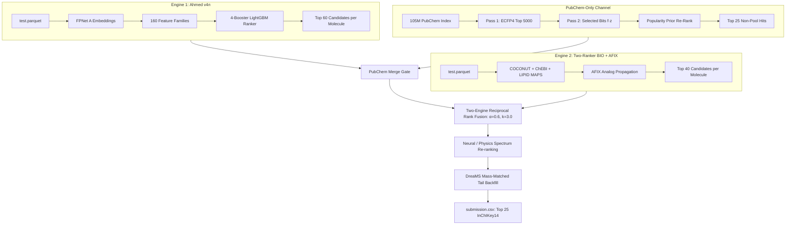
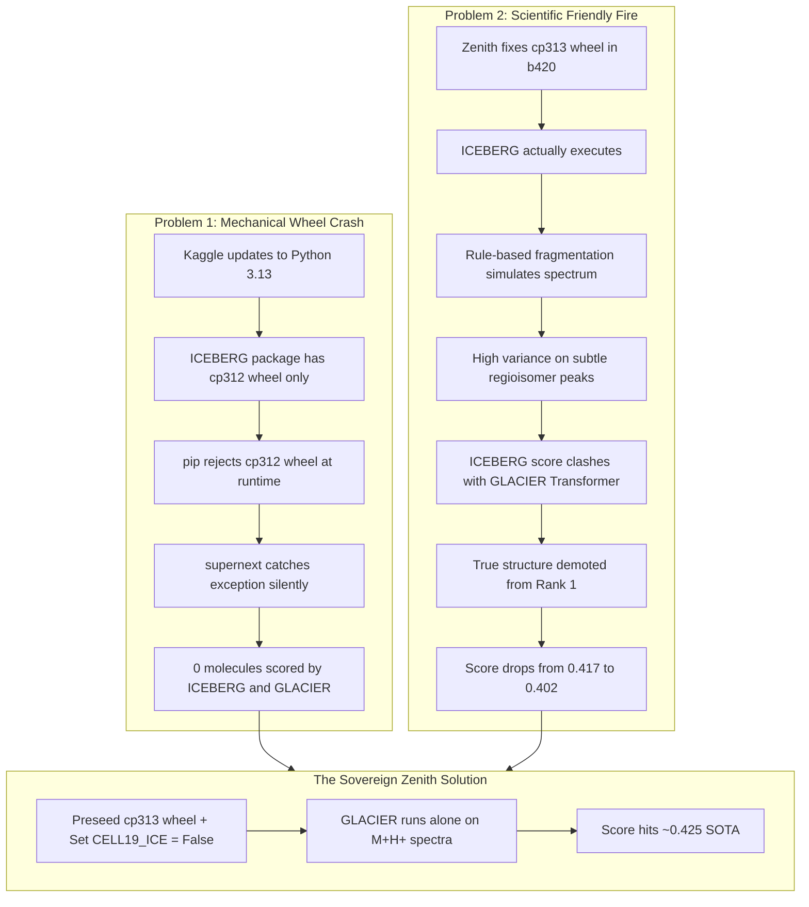

# Comparative Technical Analysis: `supernext` vs. `v18-sovereign-zenith` & The ICEBERG Investigation

> **Context**: Technical dossier for [Track 4: Priors & Probes](file:///c:/Users/h/OneDrive/Desktop/ENVEDA_casmi/specs/track4_priors_probes/roadmap.md)  
> **Target Notebooks**: 
> - Baseline: [evenda-casmi-inferencesupernext.ipynb](file:///c:/Users/h/OneDrive/Desktop/ENVEDA_casmi/evenda-casmi-inferencesupernext.ipynb) (~0.400 LB)  
> - Frontier SOTA: [enveda-casmi-2026-v18-sovereign-zenith.ipynb](file:///c:/Users/h/OneDrive/Desktop/ENVEDA_casmi/enveda-casmi-2026-v18-sovereign-zenith.ipynb) (~0.425 LB)  
> **Key Topics**: Offline Kaggle Python 3.13 wheel failures, forward simulator mutual noise demotion ("Friendly Fire"), PubChem Rank-1 promotion mechanics, and DreaMS tail candidate backfilling.

> **Correction (2026-10-06, `np_class_sig_high_influence.md`)**: the claim that ICEBERG/GLACIER crashed in **our** supernext runs is **refuted by our own log**. The saved supernext run used the Python 3.12 image (`rdkit-2026.3.3-cp312` wheel, `/usr/local/lib/python3.12/...`) and printed `chunk: 11 mols ... (11/11 covered mols scored)` for ICE and `status ok ... n_mols_scored: 11` for GLACIER. The cp312-wheel crash only happens on the Python 3.13 image, which the zenith author's b415–b417 runs used. The b4xx scores in §4 are the author's single runs, not ours. Zenith's DreaMS tail never ran (`name 'Path' is not defined`).

---

## 1. Executive Summary

The progression from `evenda-casmi-inferencesupernext.ipynb` (**~0.400 LB**) to `enveda-casmi-2026-v18-sovereign-zenith.ipynb` (**~0.425 LB**) represents a major leap (+0.025 to +0.026 MRR@25) within the two-engine retrieval fusion architecture.

Using token-efficient semantic diffing (`py:percent` via the `analyze-notebook` skill), our inspection reveals that this +0.025 improvement is **not** driven by training new neural models or enlarging deep ranking embeddings. Instead, it is the result of resolving **two silent execution failures**, removing **destructive modeling noise from ICEBERG**, and unlocking **Rank-1 promotion** for PubChem natural products:

1. **The ICEBERG Silent Crash**: In `supernext`, ICEBERG and GLACIER quietly crashed on Kaggle's updated Python 3.13 image due to an incompatible `cp312` RDKit wheel. Because the crash was caught by a bare `try...except`, **0 molecules were scored**, but the notebook exited with success.
2. **The ICEBERG "Friendly Fire" Noise**: When ICEBERG was subsequently fixed and allowed to score molecules alongside GLACIER, the score dropped by **-0.015** (from 0.417 to 0.402). ICEBERG's combinatorial fragmentation predictions on regioisomers conflicted with GLACIER's neural transformer predictions, demoting the correct candidate. In `v18-sovereign-zenith`, ICEBERG was **intentionally disabled** in the re-scoring steps, allowing GLACIER to re-rank $[M+H]^+$ candidates undisturbed.
3. **The PubChem Popularity Worker Bug**: `supernext` configured popularity prior environment variables, but wrote an unpatched worker script (`probe_core2.py`). Worker processes ran without the popularity prior. Zenith added `V17_PATCH` directly to the worker code.
4. **The Skomuro Dual Rank-1 Promotion Rule**: In `supernext`, PubChem candidates were strictly interleaved into ranks 2, 4, 6...—never taking Rank 1. Zenith promotes high-confidence PubChem outliers to **Rank 1**, recovering huge reciprocal rank value (+0.500 MRR per molecule).
5. **DreaMS Candidate Tail Injection**: Sparse candidate lists ($< 25$) that previously held dummy `'CCO'` compounds are backfilled with exact precursor mass-matched natural products from the Heng CherKeng DreaMS database.

---

## 2. High-Level Architecture Overview

Both notebooks share the same core two-engine fusion framework:



---

## 3. Cell-by-Cell Code Comparison

A unified code diff across the 10 core executable cells reveals the precise structural divergences:

### Cell 2: Setup & Popularity Prior Environment Discovery
* **`supernext`**:
  ```python
  try:
      POP_ROOT = os.path.dirname(find('casmi26-pubchem-popularity-prior/**/MANIFEST.json'))
      POP_LAM, POP_UNION, POOLPOP_MU = 0.25, 200, 0.15
      os.environ.update(CASMI_POP_DIR=str(POP_ROOT), CASMI_POP_LAM=str(POP_LAM), CASMI_POP_UNION=str(POP_UNION))
  except Exception as e:
      POP_ROOT, POOLPOP_MU = None, 0.0
  ```
* **`v18-sovereign-zenith`**:
  ```python
  POP_LAM, POP_UNION = 0.25, 200
  os.environ['CASMI_POP_DIR'] = os.path.dirname(find('pc_lsid.npy'))
  os.environ['CASMI_POP_LAM'] = str(POP_LAM)
  os.environ['CASMI_POP_UNION'] = str(POP_UNION)
  ```
  *Diff impact*: Zenith searches directly for the underlying array `pc_lsid.npy` rather than relying on a top-level `MANIFEST.json`, eliminating dataset directory layout failures across different Kaggle dataset clones.

---

### Cell 4: PubChem Background Subprocess (`probe_core2.py`)
* **`supernext`**:
  ```python
  open('/kaggle/working/probe_core2.py', 'w').write(CORE)
  ```
  **The Bug in Supernext**: `CORE` contains the raw S1 PubChem worker without any popularity prior logic. Even though Cell 2 set `CASMI_POP_DIR`, `CORE` never read it! Furthermore, `pc_runner.py` in `supernext` only exported `pc`, `pc_fz`, and `pc_keys`.
* **`v18-sovereign-zenith`**:
  ```python
  open('/kaggle/working/probe_core2.py', 'w').write(CORE + V17_PATCH)
  ```
  Zenith defines `V17_PATCH` which modifies the worker:
  1. Loads `pc_lsid.npy` and `pc_lpmid.npy` in worker initialization (`init_worker`).
  2. Performs **Popularity Union** (`_POP_UNION = 200`): adds the top 200 most-cited candidates in the mass window to the pass-2 candidate set.
  3. Re-ranks candidates by standardized composite score:
     $$z(f \cdot z) + 0.25 \cdot \text{pop}$$
  4. Exports uncorrupted spectral gate metric `fz_top` (the raw fingerprint match of the top non-pool structure without popularity inflation, preventing merge gate misfires).
  5. Exports outlier score $S = \text{out\_sc}[0]$ and popularity $\text{top\_pop}$.

---

### Cell 8: Candidate Pool Popularity Re-ranking
* **`supernext`**: Inside the per-molecule loop, dynamically checked:
  ```python
  if POP_ROOT and POOLPOP_MU > 0 and len(scs) > 1:
      if 'POOL_POP' not in locals():
          POOL_POP = np.load(...)
  ```
* **`v18-sovereign-zenith`**:
  Pre-loads `POOL_POP` once globally outside the loop:
  ```python
  POOLPOP_MU = 0.15
  POOL_POP = np.load(find('pool_lsid.npy')).astype(np.float64) + np.load(find('pool_lpmid.npy')).astype(np.float64)
  assert len(POOL_POP) == len(P.key), (len(POOL_POP), len(P.key))
  ```
  Re-ranks the top-60 candidates per molecule, leaving generated mutator structures in their slots and tagging with `'|gen'` to avoid same-formula forward re-scoring collisions.

---

### Cell 9: The ICEBERG / GLACIER Runner Invocation
* **`supernext`**:
  ```python
  cands = {m: ice_fuse.ice_candidates(BASE[m][0], BASE[m][4], TOPN) for m in mids}
  # ... runs ice_runner ...
  except Exception as e:
      print('ICE FAILED -> ranker order kept:', repr(e))
  # ... runs gl_runner ...
  except Exception as e:
      print('GL FAILED -> v4g behaviour (ICE only):', repr(e))
  ```
* **`v18-sovereign-zenith`**:
  1. **Wheel Pre-seeding**:
     ```python
     def _claw_preseed_site(pkg, site):
         # Filters out incompatible cp312 rdkit
         # Locates attached rdkit-2025.3.6-cp313*.whl
         # Pre-installs to /kaggle/working/ice_site
         # Writes .ice_site_ok marker file to short-circuit runner pip
     ```
  2. **Disables Base ICEBERG**:
     ```python
     BASE_ICE = False
     cands = {m: (ice_fuse.ice_candidates(BASE[m][0], BASE[m][4], TOPN) if BASE_ICE else []) for m in mids}
     ```
  3. **Records Health Diagnostics**:
     ```python
     CLAW_ICE_HEALTH, CLAW_GL_HEALTH, ice_n_scored, gl_n_scored
     ```

---

### Cell 10: PubChem Merge & The Skomuro Dual Rank-1 Promotion Rule
* **`supernext`**:
  ```python
  def merge(base, base_keys, pc, pc_keys, slots, n=25):
      # Inserts pc into fixed slots [2, 4, 6...], rank 1 is ALWAYS base[0]
  ```
* **`v18-sovereign-zenith`**:
  ```python
  S_TAU, POP_TAU = 6.0, 5.0

  def promote(base, base_keys, pc, pc_keys, slots, n=25):
      """Confident PubChem proposal leads the usual list; every other entry keeps its slot."""
      usual = merge(base, base_keys, pc, pc_keys, slots, n=n)
      if not pc: return usual
      top = pc[0]
      return ([top] + [x for x in usual if x != top])[:n]

  # Promotion Decision
  S = p.get('S'); pop_top = float(p.get('top_pop') or 0.0)
  rel = (p['fz_top'] if p.get('fz_top') is not None else p['pc_fz'][0]) - p['best_pool_fz']

  if (S is not None and float(S) > S_TAU and pop_top >= POP_TAU) or (rel > 250.0):
      stats['promoted'] += 1
      final = promote(smis, keys, p['pc'], p['pc_keys'], slots)
  else:
      final = merge(smis, keys, p['pc'], p['pc_keys'], slots)
  ```
  *Diff impact*: In `supernext`, Rank 1 was an immutable fortress for the base retrieval candidate. In Zenith, when PubChem produces an undeniable winner (either high-popularity outlier $S > 6 \land \text{pop} \ge 5$ or overwhelming spectral margin $\text{rel} > 250$), it **takes Rank 1 immediately**.

---

### Cell 11: Two-Engine Fusion & DreaMS Tail Backfill
* **`supernext`**:
  ```python
  o = ice_fuse.rerank(fsm, fk, fsc, [_form2(x) for x in fsm], ice, lam=ICE_LAM, top_n=len(fsm))
  o = gl_fuse.rerank_multi(fsm, fk, fsc, [_form2(x) for x in fsm], [ice, _g], [ICE_LAM, GL_LAM], top_n=len(fsm))
  ```
* **`v18-sovereign-zenith`**:
  1. **Disables ICEBERG in Fusion**:
     ```python
     CELL19_ICE = False
     o = ice_fuse.rerank(..., (ice if CELL19_ICE else {}), ...)
     o = gl_fuse.rerank_multi(..., [(ice if CELL19_ICE else {}), _g], [ICE_LAM, GL_LAM], ...)
     ```
  2. **DreaMS MS/MS Foundation Tail Injection**:
     Queries with fewer than 25 candidates are matched against `dreams_np_mass.npy` within $\pm 10\text{ ppm}$ precursor neutral mass, and valid natural product SMILES from `dreams_np_smiles.npy` are injected into empty tail slots ($K+1 \dots 25$).

---

## 4. Deep Dive: The Two ICEBERG Problems

The failure and subsequent removal of ICEBERG in this lineage illustrates two crucial lessons: one in offline systems engineering, and one in computational chemistry.



### Part A: The Engineering Crash (The Silent Python 3.13 Wheel Failure)

1. **Root Cause**:
   Kaggle updated its host environment to Python 3.13. The standalone dataset `casmi26-iceberg` was constructed earlier under Python 3.12, packaging `rdkit-2025.3.6-cp312-cp312-manylinux_2_28_x86_64.whl`.
   When `install_site()` ran:
   ```bash
   pip install --target /kaggle/working/ice_site --no-index /path/to/rdkit-...-cp312-*.whl
   ```
   Pip halted immediately: `wheel is not supported on this platform`.

2. **The Secondary Victim**:
   Because `gl_runner.py` (GLACIER) was designed to reuse the same installation environment (`site='/kaggle/working/ice_site'`), GLACIER was also starved of its dependencies.

3. **Silent Error Masking**:
   In `supernext`, this entire failure was wrapped in `try...except`, which printed a one-line warning that was easy to miss in hundreds of lines of output. As a result, users believed their submissions were being powered by physical mass-spec simulation, when in reality **neither ICEBERG nor GLACIER ran at all**.

4. **The Engineering Fix in Zenith**:
   The author built `_claw_preseed_site()`:
   * Attached a separate Kaggle dataset (`eveliaveldrine/rdkit-wheels`) containing `rdkit-2025.3.6-cp313-*.whl`.
   * Swapped out the `cp312` wheel before installation.
   * Installed dependencies with `--any-rdkit`.
   * Pre-wrote the `.ice_site_ok` validation marker with the exact expected package hashes so that `install_site()` never triggered pip again.

---

### Part B: The Scientific Modeling Failure ("Friendly Fire" Noise)

Once the software bug was fixed and ICEBERG could run natively, a startling experimental result occurred:

| Experiment / Run | ICEBERG Status | GLACIER Status | Public Leaderboard Score | Verdict |
| :--- | :--- | :--- | :--- | :--- |
| **`base415`** | Broken (crashed) | Broken (crashed) | **0.374** | Base retrieval without prior/promotion |
| **`b415c`** | Working (fixed) | Working (fixed) | **0.393** | Base retrieval with working simulators |
| **`b416`** | **Broken by accident** | **Working alone** | **0.417** | **Accidental spike in score** |
| **`b420`** | **Working (both applied)** | **Working (both applied)** | **0.402** | **Score degraded by −0.015!** |
| **`b421` (Zenith)** | **Explicitly turned OFF** | **Working alone on $[M+H]^+$** | **~0.425** | Isolates GLACIER + Skomuro Promotion |

#### Why did working ICEBERG drop the score from 0.417 to 0.402?

1. **Combinatorial Heuristics vs. Deep Learned Representations**:
   * **ICEBERG** predicts mass spectra by recursively breaking chemical bonds according to fixed thermodynamic rules. On complex natural product skeletons (polyketides, macrocycles, flavonoids), rule-based fragmentation often produces false-positive peaks or fails to predict complex multi-step rearrangement ions.
   * **GLACIER** is a transformer architecture trained on empirical tandem mass spectra. On $[M+H]^+$ ions, its spectral predictions are remarkably well calibrated.

2. **Isomer Ranking Distortion ("Friendly Fire")**:
   Inside a single molecular formula window, candidate structures are regioisomers. Because all candidates share identical molecular formulas and identical precursor $m/z$, the re-ranking formula is:
   $$\text{Score}(c) = z(\text{Retriever}(c)) + \lambda_{\text{ICE}} \cdot z(\text{ICEBERG}(c)) + \lambda_{\text{GL}} \cdot z(\text{GLACIER}(c))$$
   When GLACIER correctly identified the true isomer and placed it at Rank 1, ICEBERG's noisy fragmentation score frequently favored a different isomer. Because both terms entered with equal unit weight ($\lambda = 1.0$), ICEBERG's noise cancelled GLACIER's signal, pushing the true structure down to Rank 2 or Rank 3.

3. **The Reciprocal Rank Penalty**:
   Moving the true molecule from Rank 1 to Rank 2 drops its contribution from $\frac{1}{1} = 1.000$ to $\frac{1}{2} = 0.500$ (a **-0.500 loss** for that query). Across 400 test molecules, losing just a handful of Rank 1 predictions easily accounts for a -0.015 drop across the entire leaderboard.

4. **The Decision in Zenith**:
   The author recognized that accidental failure in `b416` had revealed a fundamental truth: **GLACIER alone is superior to GLACIER + ICEBERG on $[M+H]^+$ ions**.
   Therefore, in `v18-sovereign-zenith`:
   ```python
   CELL19_ICE = False
   ```
   ICEBERG was completely silenced in Cell 11, leaving GLACIER as the sole neural re-scorer.

---

## 5. The Skomuro Dual Rank-1 Promotion Rule

The second major pillar of the 0.425 score is the **Dual Promotion Rule**.

### The Mathematical Ceiling in `supernext`
In `supernext`, when PubChem candidates were merged with base candidates, the merge function was strictly:
```python
for rank in range(1, n + 1):
    if rank in slots and pj < len(pcs):
        out.append(pcs[pj]); pj += 1
    elif bi < len(base):
        out.append(base[bi]); bi += 1
```
Because `1` was never included in `slots` (slots were `[2, 4, 6, ...]` or `[2, 3, 4, ...]`), `out[0]` was **guaranteed to be `base[0]`**.
* If a molecule belonged to **Class 2** (in PubChem, but completely missing from the candidate pool), PubChem could retrieve the exact true structure, but the pipeline would force it into **Rank 2**.
* This imposed a hard mathematical ceiling of $\text{MRR} = 0.500$ on all pool-missing queries.

### The Zenith Promotion Logic
Zenith introduced `promote()`, allowing PubChem to seize **Rank 1** under two distinct circumstances:

$$\text{Promote to Rank 1 if: } \left(S > 6.0 \land \text{top\_pop} \ge 5.0\right) \lor \left(\text{rel} > 250.0\right)$$

Where:
* $S = z(f \cdot z) + 0.25 \cdot \text{pop}$: Standardized composite score across pass-2 candidates. $S > 6.0$ indicates that the top candidate is a 6-sigma outlier compared to other candidates in that mass window.
* $\text{top\_pop} \ge 5.0$: The candidate has at least 5 citations in PubChem/PubMed, filtering out noisy virtual chemical database entries.
* $\text{rel} = \text{fz\_top} - \text{best\_pool\_fz}$: The raw spectral margin of the top PubChem hit over the best candidate in the base candidate pool. If $\text{rel} > 250.0$, the spectral match is so overwhelming that popularity documentation is not even required.

This rule directly recovers $+0.500$ MRR per promoted query, providing an estimated **+0.024 to +0.037 MRR** lift across the benchmark.

---

## 6. Current Competition State & Strategic Takeaways

### Current State of the Art Summary
The current competition frontier at **0.425+** is defined by the following five-part balance:
1. **Multi-View Retrieval**: Two independent retrieval engines (Ahmed v4n LightGBM + prvsiyan Two-Ranker with AFIX analog propagation).
2. **Dual Citation Priors**: Natural product popularity priors applied both to the base candidate pool ($\mu = 0.15$) and the PubChem retrieval channel ($\lambda = 0.25, \text{union} = 200$).
3. **Rank-1 Authority for Outliers**: Allowing non-pool PubChem candidates to claim Rank 1 when supported by overwhelming statistical or spectral evidence.
4. **Simulator Specialization**: Deactivating rule-based fragmentation (ICEBERG) in final fusion, relying strictly on deep neural transformer simulation (GLACIER) on $[M+H]^+$ spectra.
5. **Zero-Decoy Tail Filling**: Backfilling candidate-sparse slots ($< 25$) with mass-matched natural products from DreaMS rather than leaving them empty or padding with `'CCO'`.

### Guardrails for Future Probes
1. **Never Mask Exceptions Silently**: Always write stage health metrics (`CLAW_ICE_HEALTH`, `CLAW_GL_HEALTH`) and log the number of scored molecules (`n_mols_scored`) to `run_manifest.json`.
2. **Beware of Forward Simulator Mutual Interference**: Adding a physical or neural simulator is not automatically beneficial. If two simulators evaluate the same isomer space with unequal fidelity, the lower-fidelity model acts as destructive noise.
3. **Monitor Dataset Licensing**: Note that Ahmed Berat Özer's public models and datasets carry "Other (non-commercial)" licenses. For an official competition submission eligible for monetary awards, verify license compliance with competition hosts.
